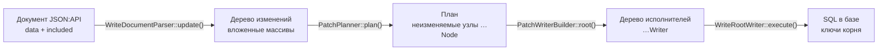
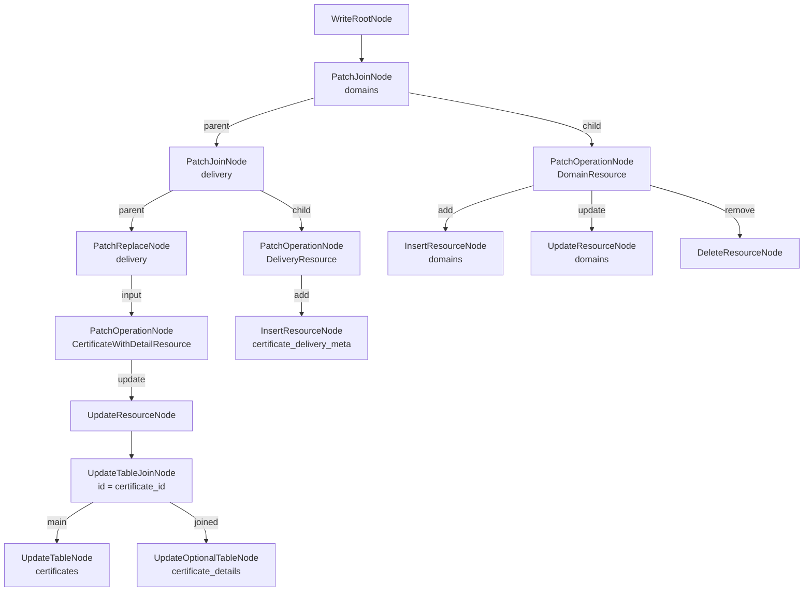
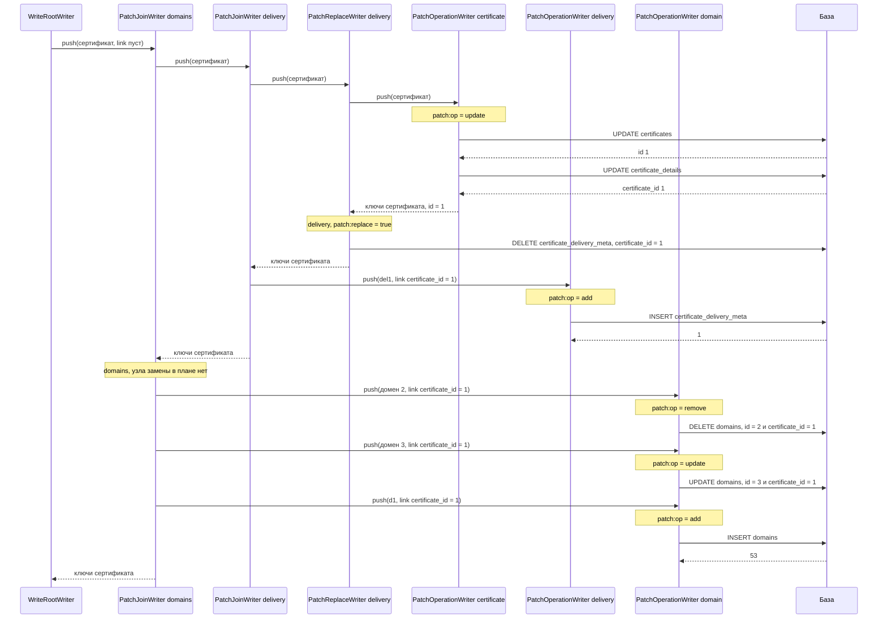

# Как выполняется обновление (PATCH): от документа до SQL

Отчёт описывает прототип `example/patch-document.php` на одном запросе — сценарии 1 этого файла
(`PATCH /certificates/1`). Все деревья, ключи и SQL ниже взяты из реального запуска:

```bash
php example/patch-document.php 2>sql.log     # деревья — в stdout, SQL — в sql.log
```

Источник правды — docblock классов в прототипе; этот файл — обзор по ним. Диаграммы написаны на Mermaid
(GitHub показывает их сразу, в PhpStorm нужно включить Mermaid в настройках Markdown).

## Содержание

1. [Конвейер целиком](#1-конвейер-целиком)
2. [Пример: запрос и база до него](#2-пример-запрос-и-база-до-него)
3. [Шаг 1. Парсер: документ → дерево изменений](#3-шаг-1-парсер-документ--дерево-изменений)
4. [Шаг 2. Планировщик: дерево изменений → план](#4-шаг-2-планировщик-дерево-изменений--план)
5. [Шаг 3. Сборщик: план → дерево исполнителей](#5-шаг-3-сборщик-план--дерево-исполнителей)
6. [Шаг 4. Выполнение: как данные идут по дереву](#6-шаг-4-выполнение-как-данные-идут-по-дереву)
7. [Другие ветви поведения](#7-другие-ветви-поведения)
8. [Ответ, транзакция, ошибки](#8-ответ-транзакция-ошибки)
9. [Карта классов](#9-карта-классов)

---

## 1. Конвейер целиком

Запрос проходит четыре стадии. Каждая превращает одно дерево в другое; база трогается только на последней.



| стадия | вход | выход | что решает | трогает базу |
|---|---|---|---|---|
| парсер | документ, класс ресурса, id из маршрута | дерево изменений | что клиент просит сделать с каждым ресурсом; все ошибки клиента 400/403/409 | нет |
| планировщик | дерево изменений | план | какие узлы нужны и в каком порядке; какие таблицы у каждого ресурса | нет |
| сборщик | план, корни, значения из маршрута | дерево исполнителей | ничего: переводит узел плана в исполнитель один к одному | нет |
| выполнение | корень дерева изменений | ключи корня | значения: какие строки менять, вставлять, удалять | да |

Три вида деревьев отличаются тем, что в них лежит:

- **дерево изменений** — данные запроса: конкретные id, значения атрибутов, операция каждого ресурса;
- **план** — только форма: какие ресурсы, связи и таблицы участвуют. Значений и id в нём нет, поэтому один план
  годится для любого запроса той же формы;
- **дерево исполнителей** — план плюс соединение с базой; строится на одно выполнение.

---

## 2. Пример: запрос и база до него

Ресурс точки входа — `CertificateWithDetailResource`: сертификат из двух таблиц
(`LeftJoin(certificates, certificate_details)`), со связями `provider` (внешний ключ), `delivery` (один к одному,
владение) и `domains` (один ко многим, владение).

**База до запроса** (сертификат 1):

| таблица | строки |
|---|---|
| `certificates` | `id 1, nominal 1000` |
| `certificate_details` | `certificate_id 1, buyer_email buyer1@example.com, recipient_name Мария Кузнецова` |
| `certificate_delivery_meta` | `certificate_id 1, delivery_channel EMAIL, is_sent 1` |
| `domains` | `1 green1.net (основной)`, `2 www.green1.net`, `3 cdn.green1.net` |

**Запрос** `PATCH /certificates/1`:

```json
{
  "data": {
    "type": "certificate",
    "id": "1",
    "attributes": {"nominal": "2500.00", "buyer_email": "new-buyer@example.com", "recipient_name": null},
    "relationships": {
      "delivery": {"data": {"type": "delivery", "lid": "del1"}},
      "domains": {"data": [
        {"type": "domain", "id": "3"},
        {"type": "domain", "id": "2", "meta": {"op": "remove"}},
        {"type": "domain", "lid": "d1"}
      ]}
    }
  },
  "included": [
    {"type": "domain", "id": "3", "attributes": {"is_primary": true}},
    {"type": "domain", "lid": "d1", "attributes": {"domain_name": "new.green1.net", "is_primary": false}},
    {"type": "delivery", "lid": "del1", "attributes": {"delivery_channel": "SMS", "is_sent": false}}
  ]
}
```

Что клиент просит:

- у сертификата поменять `nominal` (таблица `certificates`), `buyer_email` и обнулить `recipient_name`
  (таблица `certificate_details`);
- доставку заменить новой (`lid` — локальный идентификатор нового ресурса, сам ресурс лежит в `included`);
- домен 3 сделать основным, домен 2 удалить, добавить новый домен `d1`. Домен 1 не назван и остаётся: в списке есть
  пометка `meta.op`, значит изменение частичное.

---

## 3. Шаг 1. Парсер: документ → дерево изменений

`WriteDocumentParser::update(document, CertificateWithDetailResource::class, id: '1')`.

Документ плоский: все связанные ресурсы лежат в `included`, а в связях — только ссылки. Парсер подставляет ресурсы на
место ссылок и каждому приписывает операцию. Весь документ проверяется до первого запроса в базу.

### 3.1. Корень

| проверка | в примере | при нарушении |
|---|---|---|
| `data` — один объект | да | 400 |
| `data.type` — тип ресурса точки входа | `certificate` | 409 |
| `data.id` равен id из маршрута | `1` | 409 |

### 3.2. Индекс `included`

Каждый ресурс `included` получает ключ `тип:id:<id>` или `тип:lid:<lid>`:

| ключ | откуда | указатель для ошибок |
|---|---|---|
| `domain:id:3` | `included[0]` | `/included/0` |
| `domain:lid:d1` | `included[1]` | `/included/1` |
| `delivery:lid:del1` | `included[2]` | `/included/2` |

Повтор ключа (в том числе совпадение с корнем `certificate:id:1`) — 400.

### 3.3. Обход корня

Корень существует, поэтому его операция — `update`. Проверяется, что ресурс можно изменять (маркер `Updatable`, иначе
403), затем атрибуты и связи.

**Атрибуты.** Каждый должен быть известен, не быть первичным ключом и не быть только для чтения; `null` допустим только
у атрибута с `nullable`. `recipient_name: null` проходит (`nullable`), `buyer_email: null` дал бы 400.

**Связь `delivery`** — один к одному, ключ на стороне сертификата (владение). Операцию даёт форма ссылки:

| ссылка | значение | в примере |
|---|---|---|
| `{type, lid}` + ресурс в `included` | заменить: текущую удалить, новую вставить | да |
| `{type, id}` + ресурс в `included` | изменить текущую | |
| `{type, id}` | оставить, только проверить | |
| `null` | удалить текущую | |

Ссылка `delivery:lid:del1` найдена в индексе и помечена использованной. Замена удаляет текущую доставку, поэтому
проверяется `Deletable` у `DeliveryResource`; новый ресурс разбирается рекурсивно с операцией `add` (проверяется
`Insertable`). Связь получает `patch:replace: true`.

**Связь `domains`** — один ко многим, владение. Сначала парсер смотрит, есть ли в списке хоть одна пометка `meta.op`.
Есть (у домена 2), значит изменение частичное: `patch:replace: false`. Без пометок это была бы полная замена списка.
Затем по элементам:

| элемент | в `included` | операция | проверка возможности |
|---|---|---|---|
| `{domain, id 3}` | да, `/included/0` | `update` | `Updatable` |
| `{domain, id 2, meta.op remove}` | нет | `remove` | `Deletable` |
| `{domain, lid d1}` | да, `/included/1` | `add` | `Insertable` |

(Элемент `{id}` без ресурса в `included` и без пометки получил бы операцию `keep`: ничего не менять, только
проверить, что ребёнок принадлежит родителю.)

### 3.4. Порядок детей

Дети связи сортируются по порядку выполнения: `remove` → `keep`/`update` → `add`. В документе было «3, 2, d1», в
дереве стало «2, 3, d1». Так значение уникальной колонки, освобождённое удалением, можно занять новым ребёнком в том же
запросе.

### 3.5. Все ресурсы использованы

Каждый ресурс `included` должен быть использован ровно один раз. Неиспользованный — 400. Поэтому результат — дерево:
у ресурса один родитель, циклов нет.

### 3.6. Результат: дерево изменений

Кратко (так его печатает прототип):

```
update certificate id 1 {"nominal":"2500.00","buyer_email":"new-buyer@example.com","recipient_name":null}
    delivery (owned to-one): replace (the current one is deleted first)
        add delivery lid del1 {"delivery_channel":"SMS","is_sent":false}
    domains (owned): partial (unlisted are kept)
        remove domain id 2
        update domain id 3 {"is_primary":true}
        add domain lid d1 {"domain_name":"new.green1.net","is_primary":false}
```

Полностью — это вложенный массив. Служебные ключи начинаются с `patch:`:

```json
{
  "type": "certificate", "id": "1",
  "attributes": {"nominal": "2500.00", "buyer_email": "new-buyer@example.com", "recipient_name": null},
  "relationships": {
    "delivery": {
      "data": [
        {"type": "delivery", "lid": "del1",
         "attributes": {"delivery_channel": "SMS", "is_sent": false}, "relationships": [],
         "patch:op": "add", "patch:pointer": "/included/2"}
      ],
      "patch:replace": true, "patch:to-one": true
    },
    "domains": {
      "data": [
        {"type": "domain", "id": "2",
         "patch:op": "remove", "patch:pointer": "/data/relationships/domains/data/1"},
        {"type": "domain", "id": "3", "attributes": {"is_primary": true}, "relationships": [],
         "patch:op": "update", "patch:pointer": "/included/0"},
        {"type": "domain", "lid": "d1",
         "attributes": {"domain_name": "new.green1.net", "is_primary": false}, "relationships": [],
         "patch:op": "add", "patch:pointer": "/included/1"}
      ],
      "patch:replace": false
    }
  },
  "patch:op": "update", "patch:pointer": "/data"
}
```

| служебный ключ | у кого | значение |
|---|---|---|
| `patch:op` | у ресурса | `add`, `update`, `keep` или `remove` |
| `patch:pointer` | у ресурса | место в исходном документе — для ошибки 404 при выполнении |
| `patch:replace` | у связи | `true` — неназванные дети удаляются |
| `patch:to-one` | у связи | связь один к одному, пришла списком из одного ребёнка или пустым |

Связь один к одному парсер тоже отдаёт списком. Благодаря этому дальше обе связи обрабатывает один и тот же код.

---

## 4. Шаг 2. Планировщик: дерево изменений → план

`PatchPlanner::plan(CertificateWithDetailResource::class, roots: [корень])`.

Планировщик смотрит только на форму дерева изменений: какие связи присутствуют и какие операции встречаются. Значения
атрибутов и id он не читает.

**Место** — ресурс вместе со всеми его элементами в одной позиции дерева: корень; все дети связи `delivery`; все дети
связи `domains`. Для каждого места строится один узел, как бы много элементов в нём ни было.

### 4.1. Построение по шагам

**Шаг 1. Место корня.** Элемент один, операция `update`. Создаётся узел-развилка с одной ветвью:

```
PatchOperationNode (CertificateWithDetailResource)
    update: UpdateResourceNode
```

Ветвей `add` и `remove` нет: таких операций у корня в документе нет.

**Шаг 2. Таблицы модели корня.** Ветвь `update` получает дерево таблиц по `model()` ресурса
(`LeftJoin(certificates, certificate_details, [id, certificate_id])`):

```
PatchOperationNode (CertificateWithDetailResource)
    update: UpdateResourceNode
        input: UpdateTableJoinNode (relation: [id, certificate_id])
            main:   UpdateTableNode (certificates,        key: id,             returning: [id])
            joined: UpdateOptionalTableNode
                update: UpdateTableNode (certificate_details, key: certificate_id)
                insert: InsertTableNode (certificate_details)
```

- `main` — главная таблица. Её строка ищется по `key: id`, значение которого известно сразу: это id ресурса.
- `joined` — присоединённая. Её строка ищется по `key: certificate_id`; значение она получит от `main`, поэтому у `main`
  в `returning` стоит `id`.
- Правая сторона `LeftJoin` необязательна: строки может не быть. Поэтому она обёрнута в `UpdateOptionalTableNode` с двумя
  входами — изменить строку или, если её нет, вставить.

**Шаг 3. Связь `delivery`.** Связи обходятся в порядке объявления в `relationships()` ресурса: `provider`, `delivery`,
`domains`. `provider` — связь по внешнему ключу: её пишет сама строка сертификата, узла у неё нет. `delivery` в документе
есть, и для неё планировщик решает два вопроса по очереди.

*Заменяется ли связь целиком?* Да: у `delivery` стоит `patch:replace: true`. Построенное дерево оборачивается в узел
замены — он удалит текущую доставку:

```
PatchReplaceNode (delivery, relation: [id, certificate_id], child_resource: DeliveryResource)
    input: PatchOperationNode (CertificateWithDetailResource) …       ← всё из шагов 1–2
```

*Есть ли у связи дети?* Да, один. Результат оборачивается в узел связи — он передаст ребёнка дальше:

```
PatchJoinNode (delivery, relation: [id, certificate_id])
    parent: PatchReplaceNode (delivery) …                             ← узел замены над сертификатом
    child:  PatchOperationNode (DeliveryResource)
        add: InsertResourceNode
            input: InsertTableNode (certificate_delivery_meta)
```

`child` — место детей связи. Элемент один, операция `add`, поэтому ветвь одна. Узел замены стоит внутри `parent`,
поэтому удаление выполнится после записи сертификата, но до вставки новой доставки.

**Шаг 4. Связь `domains`.** У неё `patch:replace: false` (в списке есть пометки `meta.op`), поэтому узла замены нет.
Дети есть, и узел связи оборачивает уже построенное дерево целиком:

```
PatchJoinNode (domains, relation: [id, certificate_id])
    parent: PatchJoinNode (delivery) …                                ← всё из шага 3
    child:  PatchOperationNode (DomainResource)
        add:    InsertResourceNode → InsertTableNode (domains)
        update: UpdateResourceNode → UpdateTableNode (domains, key: id)
        remove: DeleteResourceNode
```

В месте `domains` три элемента с тремя разными операциями, поэтому у развилки три ветви. Узел при этом один: будь в
списке сто доменов, план был бы тем же.

**Шаг 5. Корень плана.** Сверху ставится `WriteRootNode`. У вложенного маршрута в нём был бы ещё узел проверки
родителя; здесь маршрут не вложенный.

### 4.2. Как меняется форма дерева

В дереве изменений связи лежат **внутри** ресурса. В плане узел связи стоит **над** ресурсом, а связи одного владельца
вытянуты в цепочку слева направо («левый глубокий список»):

```
дерево изменений (данные)                 план (форма)

certificate                               WriteRootNode
├── delivery (замена)                     └── PatchJoinNode domains
│   └── del1                                  ├── parent: PatchJoinNode delivery
└── domains (частично)                        │   ├── parent: PatchReplaceNode delivery
    ├── 2                                     │   │   └── input: PatchOperationNode certificate
    ├── 3                                     │   └── child:  PatchOperationNode delivery
    └── d1                                    └── child:  PatchOperationNode domain
```

Зачем цепочка: верхний узел сначала вызывает нижний (`parent`), получает от него ключи владельца и только потом пишет
своих детей. Порядок записи читается снизу вверх: сертификат → удаление прежней доставки → новая доставка → домены. Это порядок объявления связей в
ресурсе, а не порядок в документе.

### 4.3. Итоговый план



### 4.4. Что в план не попадает

План описывает, что в месте **бывает**; для какого элемента — говорят данные.

| остаётся данными | что из этого есть в плане | почему не всё |
|---|---|---|
| операция элемента (`patch:op`) | ветви `add` / `update` / `remove` места | один узел места обслуживает все элементы; ветвь выбирается по элементу |
| признак полной замены (`patch:replace`) | узел `PatchReplaceNode` связи | место одно на всех владельцев: один может заменять связь, другой — менять частично |
| id и значения атрибутов | ничего | план не зависит от значений |

Три формы одной связи в плане:

| в документе | узлы связи |
|---|---|
| частичное изменение (есть `meta.op`) | только `PatchJoinNode` |
| полная замена с элементами, замена to-one через `lid` | `PatchReplaceNode` под `PatchJoinNode` |
| полная замена пустым списком, `delivery: null` | только `PatchReplaceNode` — детей нет, передавать нечего |

Вторую и третью форму показывают сценарии 8 и 9 прототипа.

У POST узла замены не бывает (у нового ресурса нечего удалять), поэтому его план совпадает с планом `InsertPlanner`.

---

## 5. Шаг 3. Сборщик: план → дерево исполнителей

`PatchWriterBuilder(pdo, lock)->root(plan, data: [корень])`.

Сборщик ничего не решает: каждый узел плана превращается в исполнитель с тем же именем (`…Node` → `…Writer`) и той же
формой. Добавляется только то, чего в плане нет:

| добавляется | куда |
|---|---|
| соединение с базой (`PDO`) | исполнителям, которые выполняют SQL |
| корни дерева изменений | `WriteRootWriter` |
| id родителя из вложенного маршрута | `RouteParentWriter` (здесь нет) |
| флаг `lock` (`FOR KEY SHARE`; в SQLite выключен) | проверкам существования |

| узел плана | исполнитель | что делает |
|---|---|---|
| `WriteRootNode` | `WriteRootWriter` | запускает дерево для каждого корня |
| `PatchJoinNode` | `PatchJoinWriter` | владелец, затем его дети с ключом владельца |
| `PatchReplaceNode` | `PatchReplaceWriter` | владелец, затем `DELETE` его детей, не названных в документе |
| `PatchOperationNode` | `PatchOperationWriter` | развилка по `patch:op` |
| `UpdateResourceNode` | `UpdateResourceWriter` | ресурс → строка «колонка → значение» |
| `UpdateTableJoinNode` | `UpdateTableJoinWriter` | главная таблица, затем присоединённая |
| `UpdateOptionalTableNode` | `UpdateOptionalTableWriter` | изменить, а если строки нет — вставить |
| `UpdateTableNode` | `UpdateTableWriter` | `UPDATE` или `SELECT` одной таблицы |
| `InsertResourceNode`, `InsertTableNode` | `InsertResourceWriter`, `InsertTableWriter` (из `src/`) | вставка |
| `DeleteResourceNode` | `DeleteResourceWriter` | `DELETE` строки главной таблицы |

Дерево исполнителей примера (форма та же, что у плана):

```
WriteRootWriter (data: 1)
    root: PatchJoinWriter (domains)
        parent: PatchJoinWriter (delivery)
            parent: PatchReplaceWriter (delivery, child_resource: DeliveryResource)
                input: PatchOperationWriter (CertificateWithDetailResource)
                    update: UpdateResourceWriter
                        input: UpdateTableJoinWriter (relation: [id, certificate_id])
                            main:   UpdateTableWriter (certificates, key: id, returning: [id])
                            joined: UpdateOptionalTableWriter
                                update: UpdateTableWriter (certificate_details, key: certificate_id)
                                insert: InsertTableWriter (certificate_details)
            child: PatchOperationWriter (DeliveryResource)
                add: InsertResourceWriter → InsertTableWriter (certificate_delivery_meta)
        child: PatchOperationWriter (DomainResource)
            add:    InsertResourceWriter → InsertTableWriter (domains)
            update: UpdateResourceWriter → UpdateTableWriter (domains, key: id)
            remove: DeleteResourceWriter (domains)
```

---

## 6. Шаг 4. Выполнение: как данные идут по дереву

### 6.1. Правило движения

У каждого исполнителя один метод:

```php
push(array $resource, array $link = []): array   // возвращает ключи
```

- **вниз** идут ресурс из дерева изменений и `$link` — колонки связи от родителя (`[certificate_id => 1]`);
- **вверх** возвращаются ключи записанной строки (`[id => 1, …]`);
- пустые ключи значат «строки нет». На уровне развилки это превращается в 404.

Общего контекста нет: всё, что узлу нужно знать о родителе, приходит в `$link`.

### 6.2. Последовательность вызовов



### 6.3. Шаг за шагом с SQL

Вызов спускается по цепочке `parent` до самого низа, и запись начинается оттуда.

**1. Сертификат: спуск до развилки.** `WriteRootWriter` → `PatchJoinWriter(domains)` → `PatchJoinWriter(delivery)` →
`PatchReplaceWriter(delivery)` → `PatchOperationWriter(certificate)`. Узлы связи и замены сначала передают ресурс вниз,
ничего не делая. Развилка видит `patch:op: update` и отдаёт ресурс ветви `update`.

**2. Ресурс → строка.** `UpdateResourceWriter` превращает ресурс в строку «колонка модели → значение» и добавляет в
`$link` первичный ключ:

```
строка: {nominal: "2500.00", buyer_email: "new-buyer@example.com", recipient_name: null}
link:   {id: 1}
```

В строку попадают только присланные атрибуты. `null` — такое же значение, как остальные: важно присутствие ключа.

**3. Главная таблица.** `UpdateTableWriter(certificates)` берёт из строки свои колонки (`nominal`) и ищет строку по
`link[id]`:

```sql
update certificates set nominal = :nominal
where id = :key and (nominal is distinct from :nominal) returning id
-- {"nominal":"2500.00","key":1} → [{"id":1}]
```

Условие `is distinct from` не даёт перезаписать строку, если значение то же. Вверх уходят ключи
`{nominal: "2500.00", id: 1}`.

**4. Присоединённая таблица.** `UpdateTableJoinWriter` берёт из ключей главной `id` и кладёт его в `$link` под именем
колонки присоединённой стороны: `{id: 1, certificate_id: 1}`. `UpdateOptionalTableWriter` видит в строке колонки
деталей и вызывает изменение:

```sql
update certificate_details set buyer_email = :buyer_email, recipient_name = :recipient_name
where certificate_id = :key
  and (buyer_email is distinct from :buyer_email or recipient_name is distinct from :recipient_name)
returning certificate_id
-- {"buyer_email":"new-buyer@example.com","recipient_name":null,"key":1} → [{"certificate_id":1}]
```

Строка нашлась, вставка не нужна. Ключи обеих таблиц сливаются и уходят вверх — это и есть ключи корня:

```json
{"nominal": "2500.00", "id": 1, "buyer_email": "new-buyer@example.com", "recipient_name": null, "certificate_id": 1}
```

**5. Связь `delivery`.** Ключи вернулись в `PatchReplaceWriter(delivery)`. Он берёт из них ключ владельца (`id = 1`,
колонка `relation[0]`). У связи `patch:replace: true`, поэтому удаляются дети, которых нет в списке. В списке только
новый ребёнок без id, значит удаляются все:

```sql
delete from certificate_delivery_meta where certificate_id = :parent_key
-- {"parent_key":1} → 1 rows
```

Узел замены возвращает ключи сертификата без изменений в `PatchJoinWriter(delivery)`. Тот отправляет ребёнка в
`child` с `link = {certificate_id: 1}` (колонка `relation[1]`). Развилка видит `add`:

```sql
insert into certificate_delivery_meta (delivery_channel, is_sent, certificate_id)
values (:delivery_channel, :is_sent, :certificate_id) returning certificate_id
-- {"delivery_channel":"SMS","is_sent":false,"certificate_id":1} → 1
```

Колонка `certificate_id` взята из `$link`: в документе её нет. Узел возвращает вверх ключи сертификата без изменений.

**6. Связь `domains`.** Ключи пришли в `PatchJoinWriter(domains)`. Узла замены под ним нет — удаления неназванных нет.
Дети идут в `child` по порядку, который задал парсер, каждый с `link = {certificate_id: 1}`:

```sql
-- домен 2, patch:op = remove
delete from domains where id = :key_id and certificate_id = :link_certificate_id returning id
-- {"key_id":2,"link_certificate_id":1} → [{"id":2}]

-- домен 3, patch:op = update
update domains set is_primary = :is_primary
where id = :key and certificate_id = :link_certificate_id and (is_primary is distinct from :is_primary)
returning id
-- {"is_primary":true,"key":3,"link_certificate_id":1} → [{"id":3}]

-- d1, patch:op = add
insert into domains (domain_name, is_primary, certificate_id)
values (:domain_name, :is_primary, :certificate_id) returning id
-- {"domain_name":"new.green1.net","is_primary":false,"certificate_id":1} → 53
```

У изменения и удаления колонка связи стоит в `WHERE`. Это проверка принадлежности: домен другого сертификата не
найдётся, ключи будут пустыми, развилка ответит 404.

**7. Конец.** Ключи сертификата возвращаются в `WriteRootWriter`. Всего семь запросов.

### 6.4. База после запроса

| таблица | было | стало |
|---|---|---|
| `certificates` | `nominal 1000` | `nominal 2500` |
| `certificate_details` | `buyer1@example.com`, `Мария Кузнецова` | `new-buyer@example.com`, `NULL` |
| `certificate_delivery_meta` | `EMAIL, is_sent 1` | `SMS, is_sent 0` (новая строка) |
| `domains` | `1`, `2`, `3` | `1` (не тронут), `3` (основной), `53 new.green1.net` |

---

## 7. Другие ветви поведения

Тот же конвейер, другие данные. SQL — из реальных запусков.

### 7.1. Полная замена списка

Список `domains` без единой пометки `meta.op` — стандартная полная замена JSON:API: названное остаётся, остальное
удаляется. В прототипе это сценарий 8.

```json
"domains": {"data": [{"type": "domain", "id": "1"}, {"type": "domain", "id": "3"}]}
```

```
domains (owned): replace (unlisted leave the relationship)
    keep domain id 1
    keep domain id 3
```

```sql
delete from domains where certificate_id = :parent_key and id not in (:listed_0, :listed_1)
-- {"parent_key":1,"listed_0":1,"listed_1":3} → 1 rows            (удалён домен 2)
select id from domains where id = :key and certificate_id = :link_certificate_id      -- keep 1: только проверка
select id from domains where id = :key and certificate_id = :link_certificate_id      -- keep 3: только проверка
```

План отличается в двух местах. Под узлом связи `domains` появляется `PatchReplaceNode (domains)` — он и выполняет
первый запрос. У места `domains` остаётся одна ветвь `update` (её же выполняет `keep`). Парсер заранее требует
`Deletable` у `DomainResource`, даже если удалять в итоге нечего.

### 7.2. Значения не изменились

Прислали те же `nominal` и `buyer_email`, что уже записаны:

```sql
update certificates set nominal = :nominal where id = :key and (nominal is distinct from :nominal) returning id
-- → []                                   строка не тронута
select id from certificates where id = :key
-- → [{"id":1}]                           но она есть: это не 404
```

`UPDATE` без результата не отличает «нечего менять» от «строки нет», поэтому следом идёт `SELECT`. То же повторяется
для `certificate_details`. Триггеры и версии строк зря не срабатывают.

### 7.3. Строки присоединённой таблицы нет

Сценарий 2 прототипа: сертификат без строки в `certificate_details`.

| прислали | что происходит |
|---|---|
| `recipient_name: null` | `UPDATE` и `SELECT` строку не нашли; все присланные значения `NULL` — вставлять нечего |
| `buyer_email`, `greeting_text` | `UPDATE` и `SELECT` строку не нашли; строка вставляется |

```sql
update certificate_details set buyer_email = :buyer_email, greeting_text = :greeting_text where certificate_id = :key and (…) returning certificate_id   -- → []
select certificate_id from certificate_details where certificate_id = :key                                                                             -- → []
insert into certificate_details (buyer_email, greeting_text, certificate_id) values (…) returning certificate_id                                       -- → 21
```

Это работа `UpdateOptionalTableWriter`: изменить, а если строки нет — вставить. Если строка есть, а прислали `NULL`,
в колонку пишется `NULL`; строка не удаляется.

### 7.4. Чужой ребёнок

Домен 4 принадлежит другому сертификату:

```json
"domains": {"data": [{"type": "domain", "id": "4", "meta": {"op": "remove"}}]}
```

```sql
delete from domains where id = :key_id and certificate_id = :link_certificate_id returning id
-- {"key_id":4,"link_certificate_id":1} → []
```

Ключи пустые, развилка отвечает ошибкой с указателем из `patch:pointer`:

```json
{"errors": [{"status": "404",
             "source": {"pointer": "/data/relationships/domains/data/0"},
             "detail": "domain 4 not found under {\"certificate_id\":1}"}]}
```

К этому моменту сертификат уже изменён двумя запросами. Откатить их должна транзакция вызывающего.

---

## 8. Ответ, транзакция, ошибки

- **Ответ.** Успешный PATCH — `204 No Content` без тела. Свежие данные клиент читает через GET. Ключи корня прототип
  печатает только для наглядности.
- **Транзакция.** Дерево её не открывает: атомарность обеспечивает вызывающий. В прототипе каждый сценарий обёрнут в
  транзакцию, которая откатывается, поэтому база примера не меняется.
- **Ошибки.**

| когда | статус | примеры |
|---|---|---|
| разбор, до первого запроса | 400 | неизвестный атрибут или связь; `null` у обязательного атрибута; лишний ресурс в `included` |
| разбор | 403 | у ресурса нет маркера `Insertable` / `Updatable` / `Deletable` для запрошенной операции |
| разбор | 409 | `data.type` или `data.id` не совпали с маршрутом |
| выполнение | 404 | ресурса нет; ребёнок принадлежит другому родителю |
| выполнение | 500 | ошибка базы как есть: несуществующая цель внешнего ключа, нарушение `NOT NULL` или уникальности |

---

## 9. Карта классов

Все классы — в `example/patch-document.php`, `src/` не меняется.

| стадия | класс | роль |
|---|---|---|
| разбор | `WriteDocumentParser` | `update()` (PATCH), а также `insert()` (POST) и `delete()` (DELETE) с общим ядром |
| план | `PatchPlanner` | дерево изменений → узлы плана; `tables()` — дерево таблиц по `model()` |
| план | `WriteRootNode`, `PatchJoinNode`, `PatchReplaceNode`, `PatchOperationNode` | корень, связь, полная замена связи, развилка по операции |
| план | `UpdateResourceNode`, `UpdateTableJoinNode`, `UpdateOptionalTableNode`, `UpdateTableNode` | изменение ресурса и его таблиц |
| план | `DeleteResourceNode`, `RouteParentNode` | удаление; родитель вложенного маршрута |
| сборка | `PatchWriterBuilder` | план → исполнители |
| выполнение | одноимённые `…Writer` | см. таблицу в разделе 5 |
| общее | `Tables`, `WriteDocumentException` | помощник и ошибка прототипа, помечены `@temporary` |

Вставка (`add`) переиспользует `src/`: `InsertPlanner::tables()`, `WriterBuilder`, `InsertResourceWriter`,
`InsertTableWriter`. POST и DELETE идут по тому же конвейеру: POST — корень с операцией `add`, DELETE — корень с
операцией `remove`.
